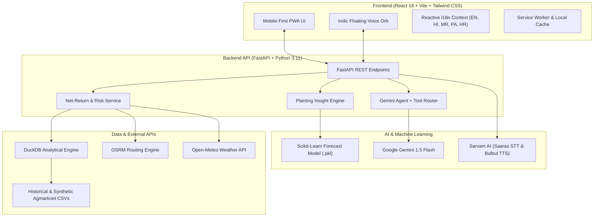

# 🌾 Kissan Saathi (किसान साथी)
### *Autonomous Agri-Tech Decision Intelligence & Multilingual AI Copilot for Indian Farmers*

[](https://vitejs.dev/)
[](https://react.dev/)
[](https://www.typescriptlang.org/)
[](https://fastapi.tiangolo.com/)
[](https://www.python.org/)
[](https://tailwindcss.com/)
[](https://deepmind.google/technologies/gemini/)
[](https://www.sarvam.ai/)
[](https://duckdb.org/)
[](https://web.dev/progressive-web-apps/)

---

## 📌 Overview

**Kisan Saathi (किसान साथी)** is an end-to-end autonomous decision intelligence platform and Indic voice assistant built for smallholder farmers across India.

Instead of only displaying spot Mandi prices, Kisan Saathi computes the farmer's **True Net Return** - deducting dynamic transport costs, transit spoilage risks, weather delays, and holding costs—to give farmers an actionable recommendation: **Sell Today, Hold for Price Surge, or Transport to a Higher-Paying Mandi**.

---

## ✨ Key Features

### 1. 🧠 True Net-Return Engine (Sell vs. Wait vs. Travel)
- Evaluates nearby and regional APMC Mandis (e.g., Vashi, Kalyan, Pune, Nashik).
- Deducts road transport costs (powered by OSRM distance matrix) and transit spoilage per crop.
- Computes holding risk and rain degradation using real-time Open-Meteo forecasts.
- Delivers a simple, actionable decision: *"Sell at Kalyan Mandi for an extra +₹4,800 net profit"*.

### 2. 🎙️ Indic Voice AI Assistant (Hands-Free Multilingual Copilot)
- **Automatic Language Identification (LID):** Automatically detects whether the farmer is speaking in **English, हिन्दी (Hindi), मराठी (Marathi), ਪੰਜਾਬੀ (Punjabi), or हरियाणवी (Haryanvi)**.
- **Voice Pipeline:** Powered by **Sarvam AI** (`saaras:v3` Speech-to-Text and `bulbul:v3` Text-to-Speech) + **Google Gemini**.
- **Autonomous Tool Invocation:** The AI agent directly queries live Mandi prices, runs forecast models, and computes holding returns dynamically during conversation.

### 3. 📈 365-Day Price Forecasting & Predictive Planting Engine
- **Trained Machine Learning Model:** Pre-trained regression model (`forecast_model.pkl`) trained on historical Agmarknet Mandi datasets.
- **Smart Planting Insights:** Considers crop biological growth cycles (Tomato: 90 days, Onion: 120 days, Potato: 100 days, Banana: 300 days).
- Back-calculates the **Optimal Planting Date** to harvest right when prices peak, ensuring farmers plant for future profit rather than past trends.

### 4. ❄️ Verified Cold Storage Directory & Navigation
- Interactive map and verified facility listings for key agricultural hubs (Navi Mumbai & Nashik).
- Includes one-tap phone dialing, storage capacities, and direct **Google Maps turn-by-turn directions**.

### 5. 🚛 Farmer Logistics Pooling
- Community-driven freight pooling allowing smallholder farmers to combine harvest loads.
- Matches farmers heading to the same Mandi to split transport truck costs by 40–60%.

### 6. 🎛️ Interactive "What-If" Market Simulator & Risk Analysis
- Interactive sliders to test sensitivity against diesel price spikes, rainfall surges, and market arrival glut.
- Transparent trust scoring indicating price data freshness and statistical anomalies.

### 7. 📱 Offline-Ready Progressive Web App (PWA)
- Fully installable on Android and iOS devices.
- Caches critical Mandi rates and recommendations so farmers can access advice even in rural low-connectivity areas.

---

## 🏗️ System Architecture



---

## 🛠️ Tech Stack

| Layer | Technologies |
| :--- | :--- |
| **Frontend** | React 18, TypeScript, Vite, Tailwind CSS, Lucide Icons, Leaflet / React-Leaflet |
| **Backend** | Python 3.11, FastAPI, Uvicorn, Pydantic v2, HTTPX |
| **AI & Voice** | Google Gemini (LLM Agent), Sarvam AI (`saaras:v3` STT, `bulbul:v3` TTS) |
| **Machine Learning** | Scikit-Learn (`forecast_model.pkl`, `encoders.pkl`), Pandas, NumPy |
| **Data Engine** | DuckDB (embedded OLAP SQL), Agmarknet historical datasets |
| **Mobile & Offline** | Vite PWA Plugin (`vite-plugin-pwa`), Workbox Service Workers |

---

## 📁 Repository Structure

```text
kissan-saathi/
├── backend/
│   ├── app/
│   │   ├── api/              # FastAPI route handlers (voice, forecast, recommend, etc.)
│   │   ├── assistant/        # Gemini AI agent, intent routing, and numeric guardrails
│   │   ├── cleaning/         # Outlier removal and normalization pipelines
│   │   ├── db/               # DuckDB connection and SQL schemas
│   │   ├── ingestion/        # Agmarknet / CEDA / Weather ingestion handlers
│   │   ├── ml_models/        # Trained forecast_model.pkl & encoders.pkl
│   │   ├── schemas/          # Pydantic data schemas
│   │   └── services/         # Net-return, cost-of-waiting, and risk scoring services
│   ├── scripts/              # DB init, synthetic data generation & model training
│   └── requirements.txt      # Python dependencies
├── dataset/                  # Agmarknet historical price reports for Maharashtra
├── docs/                     # Architecture documentation and screenshots
├── frontend/
│   ├── public/               # PWA manifests, icons, and static assets
│   ├── src/
│   │   ├── api/              # API client connectors
│   │   ├── assets/           # Media & visual assets
│   │   ├── components/       # Reusable UI widgets (Voice Orb, Mandi Map, Charts, etc.)
│   │   ├── context/          # React Contexts (Global Language State i18n)
│   │   ├── hooks/            # Custom React hooks (voice recording, offline detection)
│   │   ├── i18n/             # Multilingual dictionaries (EN, HI, MR, PA, HR)
│   │   ├── pages/            # View pages (Home, Mandis, Predict, ColdStorage, Pooling)
│   │   └── utils/            # Planting insight algorithms and utility functions
│   ├── package.json          # Node dependencies
│   └── vite.config.ts        # Vite & PWA configuration
├── .env.example              # Template for environment variables
├── .gitignore                # Clean production-grade Git ignore rules
└── README.md                 # Project documentation
```

---

## 🚀 Quickstart Guide

### 1. Prerequisites
- **Node.js** (v18.0 or higher)
- **Python** (v3.11 or higher)
- **Git**

### 2. Clone the Repository
```bash
git clone https://github.com/saruk-vedant/kissan-saathi.git
cd kissan-saathi
```

### 3. Environment Configuration
Copy the template environment file and add your API keys:
```bash
cp .env.example .env
```
Open `.env` in an editor and supply your keys:
```env
GEMINI_API_KEY=your_google_gemini_api_key
SARVAM_API_KEY=your_sarvam_ai_api_key   # Optional, enables Indic Voice STT/TTS
DATA_MODE=auto
```

For the frontend, set the backend URL (defaults to `http://localhost:8000`):
```env
VITE_API_URL=http://localhost:8000
```

---

### 4. Backend Setup & Run

1. **Create and activate a Python virtual environment:**
   ```bash
   # On Windows (PowerShell)
   python -m venv venv
   .\venv\Scripts\Activate.ps1

   # On macOS / Linux
   python3 -m venv venv
   source venv/bin/activate
   ```

2. **Install Python dependencies:**
   ```bash
   pip install -r backend/requirements.txt
   ```

3. **Initialize the local DuckDB database:**
   ```bash
   python backend/scripts/init_db.py
   python backend/scripts/ingest.py
   ```

4. **Launch the FastAPI Server:**
   ```bash
   uvicorn backend.app.main:app --port 8000 --reload
   ```
   *The backend will be available at: [http://localhost:8000](http://localhost:8000) (Swagger docs at `/docs`).*

---

### 5. Frontend Setup & Run

1. **Open a new terminal and navigate to the frontend folder:**
   ```bash
   cd frontend
   ```

2. **Install Node dependencies:**
   ```bash
   npm install
   ```

3. **Start the Vite development server:**
   ```bash
   npm run dev
   ```
   *The web application will launch at: [http://localhost:5173](http://localhost:5173).*

---

## 🧪 Production Build & Verification

To verify that the frontend compiles cleanly for production:
```bash
cd frontend
npm run build
```
This produces an optimized, minified PWA bundle in `frontend/dist/` with precached service workers.

---

## 🌐 Supported Indic Languages

| Language | Code | Script | Voice TTS Speaker |
| :--- | :---: | :--- | :--- |
| **English** | `en` | Latin | `kavya` |
| **हिन्दी (Hindi)** | `hi` | Devanagari | `ritu` |
| **मराठी (Marathi)** | `mr` | Devanagari | `roopa` |
| **हरियाणवी (Haryanvi)** | `hr` | Devanagari | `ritu` |
| **ਪੰਜਾਬੀ (Punjabi)** | `pa` | Gurmukhi | `kavya` |

---

## 📄 License & Attribution

- Built with ❤️ for empowering Indian farmers with actionable data and conversational AI.
- Mandi Price Data sourced from [Agmarknet / Data.gov.in](https://data.gov.in).
- Weather information provided by [Open-Meteo](https://open-meteo.com/).
